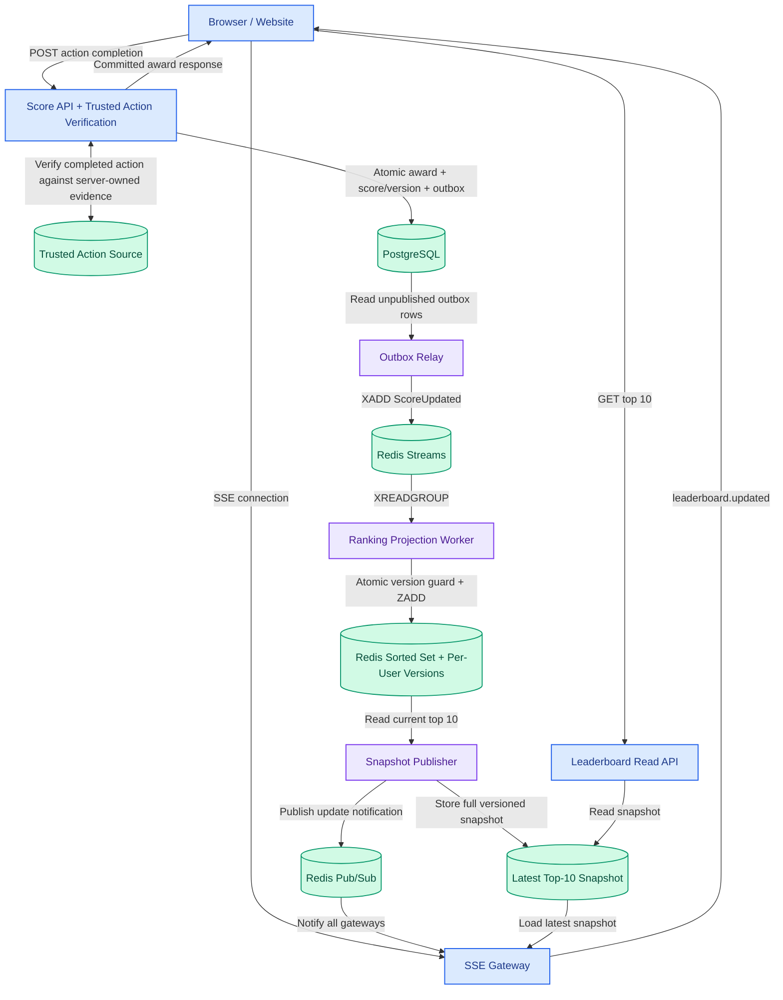
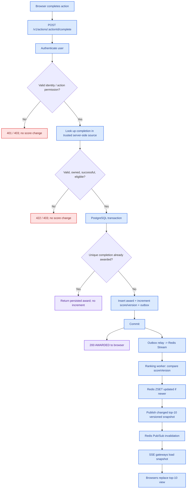
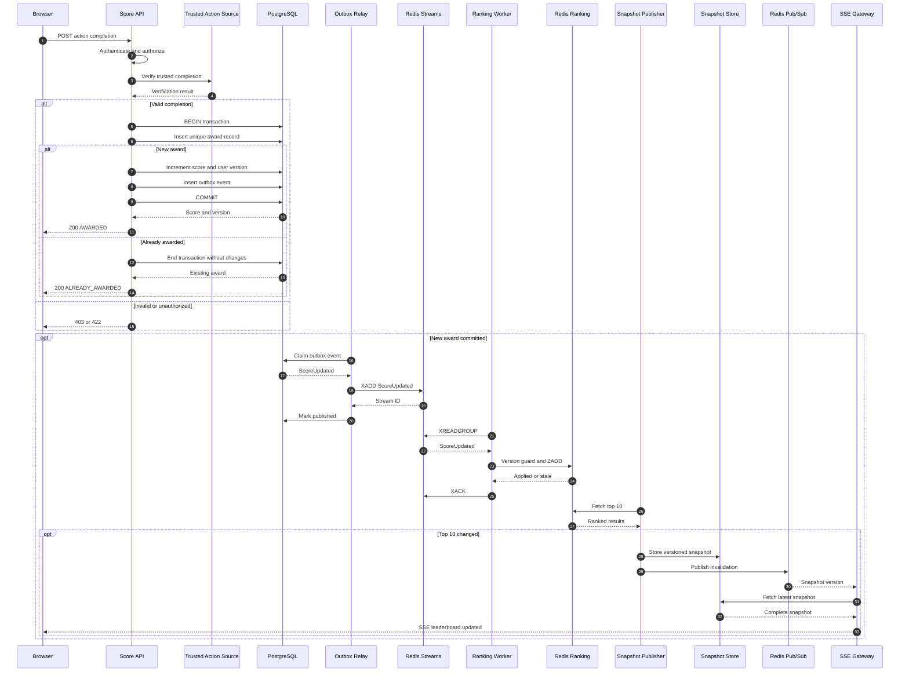

# 🏆 Real-Time Top-10 Leaderboard

> **Backend Module Specification** · Engineering implementation guide

| Metadata | Value |
|---|---|
| **Version** | 1.1 |
| **Status** | Proposed for implementation · Business rules pending approval |
| **Updated** | 2026-10-20 |
| **Audience** | Backend engineering · QA · Technical reviewers |
| **Scope** | One global cumulative-score leaderboard · Verified awards · Live updates |
| **Architecture** | PostgreSQL · Transactional Outbox · Redis Streams · Sorted Set · SSE |

> [!IMPORTANT]
> **Architecture decision — correctness first, scale on evidence**  
> PostgreSQL owns authoritative scores and award history. Only trusted action completions can generate points. Redis maintains a version-safe top-10 read model; SSE sends live snapshots. Large-scale sharding and automated CDC recovery are deferred until justified.

**Jump to a section:** [Requirements](#-1-requirements-and-implementation-summary) · [Execution flow](#-2-execution-flow) · [API contracts](#-3-api-contracts) · [PostgreSQL](#-4-postgresql-data-model-and-award-transaction) · [Ranking](#-5-event-projection-and-ranking) · [Security](#-6-security-how-the-api-prevents-cheating) · [Operations](#-7-failure-cases-validation-operations) · [Decisions](#-8-open-decisions-implementation-blockers-vs-tuning) · [Future](#-9-optional-future-improvements-not-mvp) · [Done](#-10-definition-of-done)

### 🧭 Reader guide

| Reader | Start here |
|---|---|
| **Backend engineers** | §1 Requirements → §2 Flow → §3 APIs → §4 DB → §5 Ranking |
| **Security / reviewers** | §1 Core rule → §6 Security → §7 Acceptance tests |
| **QA / SRE** | §3 Error contracts → §7 Failure handling and testing → §8 Decisions |

> [!NOTE]
> **Scope:** This README is the implementation-facing specification. Features and workloads that are not part of the task are clearly separated under **MVP vs deferred work** and **§9 Optional future improvements**.

---

## 🔵 1. Requirements and implementation summary

| ID | Product requirement | Required backend behavior | Acceptance evidence |
|---|---|---|---|
| R1 | Show the ten highest-scoring users | `GET /v1/leaderboards/global/top` returns at most ten ranked users | Correct sorted top 10, including ties |
| R2 | Live scoreboard | SSE publishes complete, versioned snapshots when the visible top 10 changes | Two connected browsers converge after an award and reconnect |
| R3 | Completed action increases score | Server calculates points after checking trusted action-completion evidence | One valid completion yields exactly one award |
| R4 | Completion sends API call | `POST /v1/actions/{actionId}/complete` accepts the completion reference | Documented request, response, and error behavior |
| R5 | Block unauthorized score inflation | Authenticate; verify action ownership and success against trusted state; deduplicate atomically | Forged, replayed, other-user, and concurrent requests award no extra points |

> [!CAUTION]
> **Core security rule — authentication is not action proof.** An authenticated API request does not prove that an action happened. The API **never** accepts client-chosen points or beneficiary IDs. A `completionId` is a locator for server-side evidence, not proof by itself.

### ⚡ Implementation in one minute

1. Browser requests an award after completing an action.
2. Score API authenticates user and verifies the completion against **trusted server-owned state**.
3. In one PostgreSQL transaction, it reserves the unique completion award, increments the user's score/version, records the award result, and inserts an outbox event.
4. API returns the **committed** result. The Redis/live path is asynchronous.
5. Outbox relay publishes absolute score/version to Redis Streams; ranking worker applies only newer per-user versions to a Redis Sorted Set.
6. Snapshot publisher detects changes to the displayed top 10, stores a versioned snapshot, and broadcasts an invalidation. SSE gateways fetch and send that complete snapshot to browsers.

### 🏗️ High-level architecture

The diagram below shows the **logical components and data flow** for the MVP. Components do not need to be deployed as separate microservices. PostgreSQL is the authoritative score store; Redis holds an eventually consistent ranking and delivery state.



**Component responsibilities**

| Component | Responsibility |
|---|---|
| **Score API + action verifier** | Authenticate the caller, validate trusted proof of action completion, calculate points, and return the committed award outcome. |
| **PostgreSQL** | Persist unique awards, authoritative per-user totals and versions, and outbox events in one transaction. |
| **Outbox Relay + Redis Streams** | Deliver committed score-change events asynchronously with at-least-once processing and retry. |
| **Ranking Projection Worker + Redis Sorted Set** | Ignore stale or duplicated score versions and maintain an efficient global score ranking. |
| **Snapshot Publisher** | Compute the visible top 10, publish a new versioned snapshot only when it changes, and signal gateways. |
| **Leaderboard Read API + SSE Gateway** | Serve the initial/current top 10 and push full snapshot updates to connected browsers; reconnect/resync after missed notifications. |

> [!TIP]
> **Two independent paths:** The **write path** ends at the PostgreSQL commit and does not wait for Redis or SSE. The **read/live path** uses the latest published snapshot and may briefly lag the authoritative score. Clients never access PostgreSQL or Redis directly.

### 🎯 MVP vs deferred work

| MVP | Future / capacity-driven enhancement |
|---|---|
| Trustworthy action verification, authentication, atomic PostgreSQL award, durable uniqueness, error/retry semantics | Additional fraud scoring, administrative corrections, seasonal resets |
| PostgreSQL transactional outbox + relay; Redis Stream consumer with retries and version checks | Broker migration or advanced change-data-capture topology |
| One global Redis Sorted Set; top-10 snapshot; read API and SSE with reconnect/resync | Partitioned ranking, cross-shard top-K merge, massive fan-out optimizations |
| Monitoring, integration tests, basic backups and a **tested recovery plan** for Redis projection | Automated zero-downtime CDC-based rebuild and complex multi-region failover |

The original architecture proposal discusses **20k awards/sec and 1M viewers**. Those are unverified hypothetical targets, not requirements for this assignment. Do not introduce sharding or many independent microservices without measured need. Logical components below may share a repository and deployments.

---

## 🟠 2. Execution flow

### 2.1 🔁 Primary flow diagram



> [!NOTE]
> **Consistency boundary:** PostgreSQL is authoritative for points; Redis and SSE are eventually consistent. API success requires a PostgreSQL commit, **not** delivery of the live update.

### 2.2 ⏱️ Award and delivery sequence



---

## 🟢 3. API contracts

### 3.1 Award a completed action

```http
POST /v1/actions/{actionId}/complete
Authorization: Bearer <access-token>
Idempotency-Key: <stable-request-key>
Content-Type: application/json

{"completionId":"550e8400-e29b-41d4-a716-446655440000"}
```

- `userId` comes **only** from the validated session/token.
- `actionId` identifies the action policy; `completionId` identifies an actual completion record in a trusted system. It is not randomly fabricated by the browser as evidence.
- Server resolves points from controlled policy. Reject client-supplied `points` / `userId` as unknown fields if strict schema validation is used.
- The `Idempotency-Key` is a transport convenience: persist/request-fingerprint it with a bounded retention policy **if implemented**. The unique **trusted completion identity** in PostgreSQL remains the permanent anti-replay guard.
- **Verification ownership:** The action-owning backend creates and controls a completion record with `{completionId,userId,actionId,status,eligible}` and exposes an authenticated service-to-service lookup (or trusted same-DB query). Verify that it is successful, assigned to the authenticated user, matches the path action, is eligible, and has not been invalidated.
- **Concurrency:** A unique DB award constraint, not a preliminary SELECT, decides the winning request. If the action can be consumed for other rewards, the action service and score service must agree on a transactional claim or reservation protocol; an uncoordinated check-then-award is insufficient.

**First award — `200 OK`:**

```json
{
  "status": "AWARDED",
  "userId": "123",
  "actionId": "daily-challenge",
  "completionId": "550e8400-e29b-41d4-a716-446655440000",
  "pointsAwarded": 10,
  "totalScore": 550,
  "scoreVersion": 12
}
```

**Repeat of the same verified completion — `200 OK`:** Return the persisted award with `status: "ALREADY_AWARDED"`. Its `totalScore` and `scoreVersion` are the values **at the original award**, not necessarily the latest account total. Confirm the stored owner/action match; do not leak another user's award.

**Error envelope:**

```json
{"error":{"code":"COMPLETION_NOT_VERIFIED","message":"Completion is not eligible for an award","requestId":"req-abc"}}
```

| HTTP | Code | Rule / retry behavior |
|---|---|---|
| `400` | `INVALID_REQUEST` | Malformed JSON, invalid identifiers or fields. Fix request; don't retry unchanged. |
| `401` | `UNAUTHENTICATED` | Missing/expired credentials. Reauthenticate. |
| `403` | `ACTION_NOT_ALLOWED` | Principal lacks permission or attempts another user's completion. Don't retry unchanged. |
| `404` | `ACTION_NOT_FOUND` | Unknown action (if disclosing action existence is safe). |
| `409` | `IDEMPOTENCY_KEY_CONFLICT` | Same transport idempotency key with a different fingerprint. Use correct original request. |
| `422` | `COMPLETION_NOT_VERIFIED` | Missing/failed/expired/ineligible server-side completion. Do not award. |
| `429` | `RATE_LIMITED` | Retry after `Retry-After`, with backoff. |
| `503` | `DEPENDENCY_UNAVAILABLE` | Trusted verification or PostgreSQL unavailable. No **new successful response**; retry with same identifiers and backoff. |
| `500` | `INTERNAL_ERROR` | Unexpected server error; retry boundedly with the **same completion and key**, because commit outcome may be uncertain. |

**Timeout / lost response:** The client cannot know whether the transaction committed. Retry **the identical completion and idempotency key**; the server returns the persisted award if it committed. An API timeout is *not* permission to send a new completion ID. A `202 Accepted` response is out of scope unless asynchronous award processing is explicitly designed.

**Duplicate validation ordering:** For a recognized duplicate, the server may return a persisted result without requiring the trusted completion to remain in an unconsumed state, **but must authenticate, check ownership/action and enforce transport-key fingerprint rules** first. For any new award, require fresh trusted verification. Make this distinction explicit in code/tests.

### 3.2 Read current top 10

```http
GET /v1/leaderboards/global/top
```

```json
{
  "leaderboardId": "global",
  "snapshotVersion": 18429,
  "generatedAt": "2026-10-20T08:00:00Z",
  "entries": [
    {"rank":1,"userId":"205","displayName":"Bob","score":950},
    {"rank":2,"userId":"101","displayName":"Alice","score":950}
  ]
}
```

Return at most ten members; fewer if fewer users are scored. Only approved public profile fields are exposed. `snapshotVersion` is a **global published snapshot version**, separate from a user's `scoreVersion`. Define `503 LEADERBOARD_UNAVAILABLE` (or an explicitly labeled cached/stale response) when the snapshot cannot be served; never mislabel stale data as fresh.

### 3.3 Subscribe to changes via SSE

```http
GET /v1/leaderboards/global/events
Accept: text/event-stream
```

```text
id: 18430
event: leaderboard.updated
data: {"snapshotVersion":18430,"generatedAt":"2026-10-20T08:00:01Z","entries":[{"rank":1,"userId":"205","displayName":"Bob","score":960}]}

```

**Client contract:** Replace the entire top-10 array if the received version is newer. On (re)connection, the gateway sends the *latest complete snapshot*, not every missed event. `Last-Event-ID` can help compare versions; it does not require replay history. Use heartbeats, appropriate proxy buffering/timeouts, bounded per-client queues, and backpressure handling. The stream may be public if profile fields are intentionally public; score awards always require authentication.

**Gateway gap protection:** Subscribe/buffer invalidations **before** reading the initial canonical snapshot, discard duplicate/older versions, and periodically re-read canonical state (e.g., configuration-driven resync) so lost Pub/Sub messages cannot cause permanent staleness.

---

## 🔷 4. PostgreSQL data model and award transaction

```sql
CREATE TABLE user_scores (
  user_id BIGINT PRIMARY KEY,
  total_score BIGINT NOT NULL DEFAULT 0 CHECK (total_score >= 0),
  version BIGINT NOT NULL DEFAULT 0,
  updated_at TIMESTAMPTZ NOT NULL DEFAULT now()
);

CREATE TABLE score_awards (
  award_id BIGSERIAL PRIMARY KEY,
  completion_id UUID NOT NULL UNIQUE,
  user_id BIGINT NOT NULL,
  action_id TEXT NOT NULL,
  points BIGINT NOT NULL CHECK (points > 0),
  total_score_after BIGINT NOT NULL,
  score_version_after BIGINT NOT NULL,
  awarded_at TIMESTAMPTZ NOT NULL DEFAULT now()
);

CREATE TABLE outbox_events (
  event_id UUID PRIMARY KEY,
  aggregate_id BIGINT NOT NULL,
  event_type TEXT NOT NULL,
  payload JSONB NOT NULL,
  created_at TIMESTAMPTZ NOT NULL DEFAULT now(),
  published_at TIMESTAMPTZ
);
CREATE INDEX idx_outbox_unpublished
  ON outbox_events(created_at) WHERE published_at IS NULL;
```

For a **one-time action**, additionally enforce `UNIQUE(user_id, action_id)` when that is the domain rule. For a **repeatable action**, every legitimate occurrence needs a distinct *server-created* completion ID. If completion identifiers are only unique per action service/tenant, replace the global UUID uniqueness constraint with the correct compound identity.

**One PostgreSQL transaction (new verified award):**

1. Verify the trusted completion/authorization; use an atomic claim or same-DB transaction if completion ownership/eligibility can race with another actor.
2. `INSERT` into `score_awards` under the unique completion constraint. On conflict, return the matching existing award and **do not** increment. Handle concurrent transactions using PostgreSQL uniqueness/locking semantics, not client-side state.
3. Increment `user_scores.total_score` and `version` with an atomic UPSERT; capture the resulting values, reject integer overflow, then persist those values in the award record.
4. Insert exactly one `ScoreUpdated` into `outbox_events`, containing the **absolute** committed score and per-user version.
5. `COMMIT` before reporting `AWARDED`; on error, **roll back all writes**.

```sql
INSERT INTO user_scores(user_id, total_score, version)
VALUES ($1, $2, 1)
ON CONFLICT (user_id) DO UPDATE
  SET total_score = user_scores.total_score + EXCLUDED.total_score,
      version = user_scores.version + 1,
      updated_at = now()
RETURNING total_score, version;
```

**Do not run this UPSERT on duplicate awards.** The transaction must ensure an award row has been reserved first. Document a transaction isolation/locking strategy in the implementation PR; `READ COMMITTED` with unique constraints and row-serialized updates can suffice for this narrow invariant if external eligibility is handled correctly.

---

## 🟣 5. Event projection and ranking

### 5.1 Event contract, delivery, and retries

```json
{
  "eventId":"c0485068-b393-4d76-a130-eaf4bea32118",
  "eventType":"ScoreUpdated",
  "schemaVersion":1,
  "aggregateId":"123",
  "occurredAt":"2026-10-20T08:00:00Z",
  "data":{"userId":"123","totalScore":550,"scoreVersion":12}
}
```

- The outbox relay claims rows using short, recoverable leases (not a DB transaction held open around network I/O), `XADD`s to Redis Streams, then marks them published **only after an ACK**. A crash after `XADD` may deliver duplicates; that is expected.
- Workers use `XREADGROUP` and `XAUTOCLAIM`; `XACK` only after atomic Redis application or a confirmed stale/duplicate no-op. Retry transient errors with bounds; quarantine malformed events and alert. An event must not be silently discarded.
- The DB-to-stream and stream-to-worker paths are **at least once**, not end-to-end exactly once. Redis loss after stream acknowledgment is possible. PostgreSQL is the recovery authority.

### 5.2 Redis Sorted Set and monotonic version guard

```text
leaderboard:{global}:scores       # ZSET: userId -> authoritative absolute totalScore
leaderboard:{global}:versions     # HASH: userId -> latest applied scoreVersion
```

Both keys share the `{global}` Redis Cluster hash tag, allowing one atomic Lua script. A **single global ZSET is a single-key write hotspot**; that is acceptable for the MVP until benchmarks prove otherwise.

```lua
-- KEYS[1] = leaderboard:{global}:scores
-- KEYS[2] = leaderboard:{global}:versions
-- ARGV = [canonicalUserId, absoluteTotalScore, scoreVersion]
local user = ARGV[1]
local score = tonumber(ARGV[2])
local version = tonumber(ARGV[3])
local current = tonumber(redis.call('HGET', KEYS[2], user) or '0')
if version <= current then return 0 end
redis.call('ZADD', KEYS[1], score, user)
redis.call('HSET', KEYS[2], user, version)
return 1
```

Example: event `(user=123, score=550, version=12)` arrives before delayed event `(user=123, score=540, version=11)`; the second event is discarded, and the projection stays at **550**. **Never apply `ZINCRBY` to replayable score-change events.** Validate integer inputs and reject a score greater than `2^53` because Redis Sorted Sets store doubles and cannot represent larger integers exactly.

### 5.3 Deterministic ranking, tie handling, and snapshots

**MVP ranking contract (explicit choice):** Higher total score ranks first; for equal scores, **canonical user ID bytes descending**. This exactly matches `ZRANGE ... REV` ordering for equal-score members. For numeric user IDs, use a *fixed-width, zero-padded decimal canonical string* for consistent tie semantics across implementations (e.g., `00000000000000000205` precedes `00000000000000000101` in descending order). Convert to the public string `userId` in response. Do not inconsistently store `205` in Redis and `000...205` elsewhere.

```redis
ZRANGE leaderboard:{global}:scores 0 9 REV WITHSCORES
```

This returns the ten globally ordered entries directly; don't fetch the first ten then apply a different tie-breaker in memory, since ties at position 10 could cause incorrect membership. If product demands ascending user ID or earlier-achievement priority, **change and test the ranking implementation**; it is not a cosmetic post-sort.

The **snapshot publisher** periodically obtains top 10 (cadence configurable), compares ordered user IDs + scores to the prior published snapshot, and only on change atomically publishes the full snapshot with a monotonically increasing `snapshotVersion`. Use one logical active writer with fencing to prevent old publishers overwriting newer snapshots. Publish a Redis Pub/Sub *invalidation* containing that version; each SSE gateway fetches the canonical snapshot once and fans it out. Missed invalidations are corrected by gateway periodic resync and browser reconnect.

A non-top-10 user's award can be committed correctly without any visible update: **do not publish an unchanged top 10**.

---

## 🛡️ 6. Security: how the API prevents cheating

**Threat model:** Attackers can inspect and forge browser requests, change completion IDs, replay captured HTTP requests, run concurrent calls, and supply valid authentication for their *own* accounts. Browser-controlled evidence cannot be trusted.

| Attack | Mandatory control | Test |
|---|---|---|
| No login / invalid token | Authenticate token/session before award access | 401; no writes |
| Claim another user's completion | Trusted completion belongs to authenticated principal; verify action | 403; no writes |
| Invent random `completionId` | Lookup successful completion in server-owned source | 422; no writes |
| Resubmit same legitimate completion | Unique durable completion constraint and persisted award result | Exactly one increment across parallel calls |
| Change score/beneficiary in payload | Ignore/reject unrecognized fields; policy points on server | Cannot alter who or how much |
| Reuse transport key for different payload | Key-to-request fingerprint conflict handling | 409; no new award |
| Flood endpoint | Per-user/IP/action rate limit; audit and anomaly alerts | 429; no unauthorized awarding |
| Redis/server-side tampering | Private networks, least-privilege credentials, secret rotation | No public Redis/DB access |

**Blocking integration decision:** The assignment does not describe how an action is completed. Therefore an actual **trusted completion source / verification contract** must be designed with the action-owning team. If completion is validated only in JavaScript or the caller can mint any accepted evidence, **requirement R5 is not met**. Rate limiting and CAPTCHA supplement verification; they cannot substitute for it.

---

## 🟩 7. Failure cases, validation, operations

| Situation | Expected behavior |
|---|---|
| Invalid, forged, other-user completion | Reject; no award, score, or outbox write |
| Two concurrent claims for one completion | Exactly one award; other returns original persisted result |
| API crash before commit | Rollback; retry can award normally |
| API crashes/timeout after commit | Retry same identifiers; no duplicate points |
| Relay crashes after `XADD`, before marking published | Possible duplicate stream event; version guard makes replay harmless |
| Worker crashes after ZSET update, before `XACK` | Reclaimed message is safe no-op |
| Older version arrives late | Redis ZSET score/version never regresses |
| Redis Pub/Sub invalidation lost | Gateway periodic refresh/reconnect sends latest snapshot |
| Slow SSE connection | Coalesce newer snapshots, cap queues, disconnect safely |
| PostgreSQL unavailable | Fail closed for new awards; return 503/500 as appropriate |
| Redis ranking unavailable/lost | Awards remain safe in PostgreSQL; return explicit stale/unavailable leaderboard state; **rebuild from trusted DB snapshot with gap-free change catch-up**, not an arbitrary partial Redis stream |

### 🧪 Required acceptance tests

- [ ] Valid completed action changes **only the authenticated user's** score, once.
- [ ] Forged/missing/failed/expired/mismatched completions never award points.
- [ ] Same completion from 100 simultaneous callers yields one award, increment, and outbox row.
- [ ] Retry after committed response loss returns original award (no extra score).
- [ ] Rollback after forced failure between SQL writes leaves no partial score/outbox data.
- [ ] Redis projection remains correct under duplicated and reversed event ordering.
- [ ] Top 10 includes no more than ten users; tied score ordering follows the documented canonical ID rule, including a tie at rank 10.
- [ ] Two SSE subscribers receive newer complete snapshots; reconnect or lost Pub/Sub invalidation resynchronizes.
- [ ] A score change outside the top 10 does not produce a pointless changed snapshot.
- [ ] Outbox/worker restarts, database/Redis outage, and projection rebuild procedures are exercised.
- [ ] Logs/metrics do not expose bearer tokens or private completion details.

**Minimum observability:** Structured request/event IDs, award outcomes, verification failures, PostgreSQL transaction errors, oldest unpublished outbox age, stream pending/lag, Redis ranking-script errors, snapshot freshness, active SSE clients/egress, and commit-to-display lag. Configure alerts and review security events without exposing sensitive details.

**Operational note:** Even in the MVP, a lost Redis projection needs a **tested recovery path**. A manual maintenance rebuild with a coordinated consistent DB snapshot and proven no-gap event catch-up is acceptable at small scale if downtime/stale-view behavior is agreed; a fully automated PostgreSQL logical decoding / CDC system is optional, not a prerequisite for this assignment.

---

## 🟡 8. Open decisions (implementation blockers vs tuning)

| Priority | Decision | Initial proposal |
|---|---|---|
| **Blocking** | Which trusted backend validates completion, ownership, status, and eligibility? | Server-owned completion record; no browser-only proof |
| **Blocking** | Are actions repeatable, and what uniquely identifies an eligible award? | Unique trusted completion instance; domain-level uniqueness |
| **Blocking** | How many points does each action grant? | Versioned server-side reward policy |
| **Blocking** | Can scoring decrease, reset, or users become ineligible? | No for MVP; if yes, design versioned deletion/reversal events |
| Approve | Tie-break on equal score | Score descending; canonical user ID **descending** (Redis native) |
| Approve | Public vs authenticated leaderboard | Public only with approved public fields |
| Approve | Freshness budget and stale behavior | Eventual consistency; measure and agree SLO |
| Capacity | Expected users, awards/sec, viewers, event retention, RPO/RTO | Measure before sharding or autoscaling design |

---

## 🚀 9. Optional future improvements

1. **Partitioned rankings:** Split members among Redis ZSETs only if a measured single-key bottleneck exists; global top 10 becomes a merge of each shard's local top 10 with identical ordering.
2. **Automated zero-downtime rebuild:** Create an isolated ranking using coordinated PostgreSQL exported snapshot and dedicated logical CDC stream; replay from a verified no-gap boundary, reconcile, fence writers, and cut over.
3. **Very large fan-out:** Horizontally scale dedicated SSE gateway fleets, isolate Redis workloads, coalesce snapshots, and validate network egress/load.
4. **Additional product rules:** Seasons, score expiration/revocation, anti-fraud adjudication, privacy deletion, and ranking of ineligible users require new domain contracts and events.

---

## ✅ 10. Definition of done

The backend team delivers: documented API endpoints/error shapes; action-verification integration; database migrations; atomic award transaction with durable uniqueness; outbox/stream relay; version-guarded Redis projection; top-10 snapshot/read path; SSE endpoint with resync; automated acceptance/security tests; and a tested recovery/runbook. **Do not approve R5 without demonstrating that invented, stolen, replayed and concurrent completion claims cannot create unauthorized score increases.**

---
